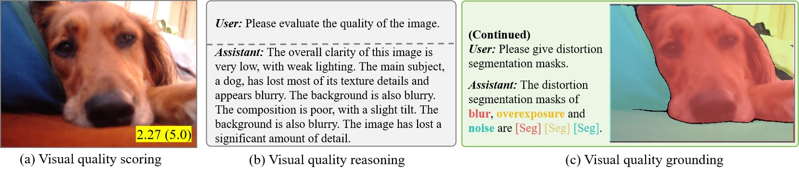

<div align="center">

## [Q-Ground: Image Quality Grounding with Large Multi-modality Models](https://arxiv.org/abs/2407.17035)

[<sup>1</sup>Chaofeng Chen](https://chaofengc.github.io), <sup>1</sup>Sensen Yang, [<sup>1</sup>Haoning Wu](https://teowu.github.io/), [<sup>1</sup>Liang Liao](https://liaoliang92.github.io/homepage/), [<sup>3</sup>Zicheng Zhang](https://zzc-1998.github.io/), [<sup>1</sup>AnnanWang](https://scholar.google.com/citations?user=vZn0gL8AAAAJ&hl=en),  [<sup>2</sup>Wenxiu Sun](https://scholar.google.com/citations?user=X9lE6O4AAAAJ&hl=en), [<sup>2</sup>Qiong Yan](https://scholar.google.com/citations?user=uT9CtPYAAAAJ&hl=en), [<sup>1</sup>Weisi Lin](https://personal.ntu.edu.sg/wslin/Home.html)  
<sup>1</sup>S-Lab, Nanyang Technological University, <sup>2</sup>Sensetime Research, <sup>3</sup>Shanghai Jiao Tong University

[](https://arxiv.org/abs/2407.17035) <a href="https://huggingface.co/collections/chaofengc/q-ground"></a> -2B9370.svg) [](https://hits.seeyoufarm.com)

</div>



Q-Ground is a multimodal model for localizing and describing image quality distortions. This repository provides the released model weights, dataset download utilities, a Gradio demo, evaluation scripts, and multi-stage training scripts used for the released version.

## Updates

✅ Release all stage model weights in 🤗Hugging Face [Q-Ground Collection](https://huggingface.co/collections/chaofengc/q-ground)  
✅ Release test codes  
✅ Release training codes  
✅ Release datasets in 🤗Hugging Face [QGround-100K](https://huggingface.co/datasets/chaofengc/QGround-100K)   

## Installation

Create a Python environment first. Install a PyTorch build compatible with your CUDA setup before installing the project dependencies.

```
conda create -n qg python=3.10 -y
conda activate qg

# Install PyTorch and DeepSpeed separately if needed for your machine.
pip install -r requirements.txt
```

## Quick Start: Run the Chat Demo 

Launch the Gradio demo:

```bash
bash test_chat.sh
```

This starts `chat_app.py`, saves predicted masks to `./tmp_chat_masks`, and exposes a local Gradio interface with example images from `./example_imgs`.

## Dataset Preparation

The training pipeline expects datasets under `./dataset`. The released dataset snapshot on Hugging Face contains the required data for training and evaluation, organized in a way that the training scripts can directly use after extraction.

### Download the dataset

Download the released dataset snapshot from Hugging Face into `./dataset`:

```bash
python download_datasets.py
```

If you do not have direct access to Hugging Face, use the mirror endpoint before downloading:

```bash
export HF_ENDPOINT=https://hf-mirror.com
python download_datasets.py
```

### Extract archives

Extract all supported archives under `./dataset`:

```bash
python extract_archives.py --root ./dataset
```

If you want to inspect or customize label processing, see `./utils_label.py`. The released download and extraction flow is intended to perform the required preparation automatically.

## Training

The released training pipeline uses four stages. Compared with the paper version, the released model adds a mask decoder pretraining stage before final Q-Ground finetuning.

| Stage | Script | Initialization | Purpose |
| --- | --- | --- | --- |
| 1 | `./train_stage1.sh` | `liuhaotian/llava-v1.5-7b` | Align multiscale visual-language features |
| 2 | `./train_stage2.sh` | Stage 1 checkpoint | Improve instruction following |
| 3 | `./train_stage3.sh` | Stage 2 checkpoint | Pretrain the mask decoder with segmentation-heavy data |
| 4 | `./train_stage4.sh` | Stage 3 checkpoint | Finetune on Q-Ground quality grounding data |

Run the stages in order using `bash train_stage[1-4].sh`.

Each stage script launches `./train_ds.py` with DeepSpeed and saves a Hugging Face-style checkpoint to a local output directory (for example, `./qg_model_multiscale_stage1` to `./qg_model_multiscale_stage4`).

### Training Notes

- The scripts expect GPUs and a working DeepSpeed installation.
- The default dataset root is `./dataset/`.
- The released Stage 3 mask decoder pretraining noticeably improves mask quality compared with the paper configuration.

## Pretrained Weights

Released checkpoints are available in the 🤗 Hugging Face [Q-Ground Collection](https://huggingface.co/collections/chaofengc/q-ground).

The default inference and evaluation scripts load `--version chaofengc/qg_model_multiscale`.
You can override `--version` in `./evaluate_model.py` or adapt the shell scripts if you want to test a local stage checkpoint.

## Benchmark Results

Evaluate the released model on the Q-Ground benchmark with:

```bash
bash test_bench.sh
```

The script runs `./evaluate_model.py` and stores outputs in `./tmp_qground_results`.

Compared with the paper, the extra mask decoder pretraining stage (Stage 3) significantly improves the mask prediction performance (mIoU), which is the key to quality grounding. The performance of the final Q-Ground model on the benchmark compared with the paper is as follows:

| Model | Jitter | Noise | Overexposure | Blur | Low light | Average |
| --- | --- | --- | --- | --- | --- | --- |
| Paper mIoU | 0.434 | 0.051 | 0.125 | 0.460 | 0.219 | 0.271 |
| Released mIoU | 0.4201 | 0.1793 | 0.2756 | 0.4651 | 0.2971 | 0.3274 |
| Paper mAcc | 0.720 | 0.176 | 0.459 | 0.648 | 0.337 | 0.539 |
| Released mAcc | 0.7187 | 0.4138 | 0.5172 | 0.6098 | 0.4461 | 0.5411 |

## Citation

If you find this work useful, please consider to cite our paper:

```bibtex
@inproceedings{chen2024qground,
      title={Q-Ground: Image Quality Grounding with Large Multi-modality Models}, 
      author={Chaofeng Chen and Sensen Yang and Haoning Wu and Liang Liao and Zicheng Zhang and Annan Wang and Wenxiu Sun and Qiong Yan and Weisi Lin},
      Journal = {ACM International Conference on Multimedia},
      year={2024},
}
```

## Acknowledgement

This project is based on [PixelLM](https://github.com/MaverickRen/PixelLM), [LISA](https://github.com/dvlab-research/lisa) and [LLaVA](https://github.com/haotian-liu/LLaVA). Thanks to the authors for their great work!